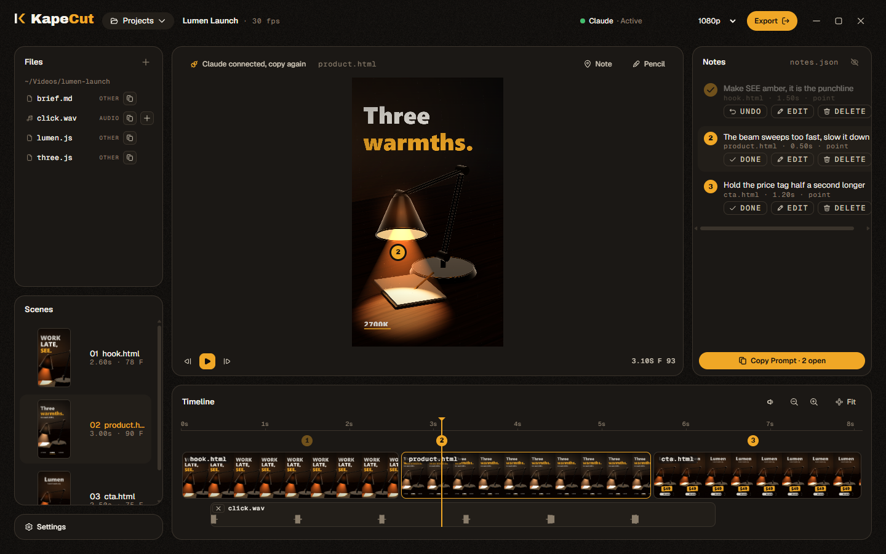
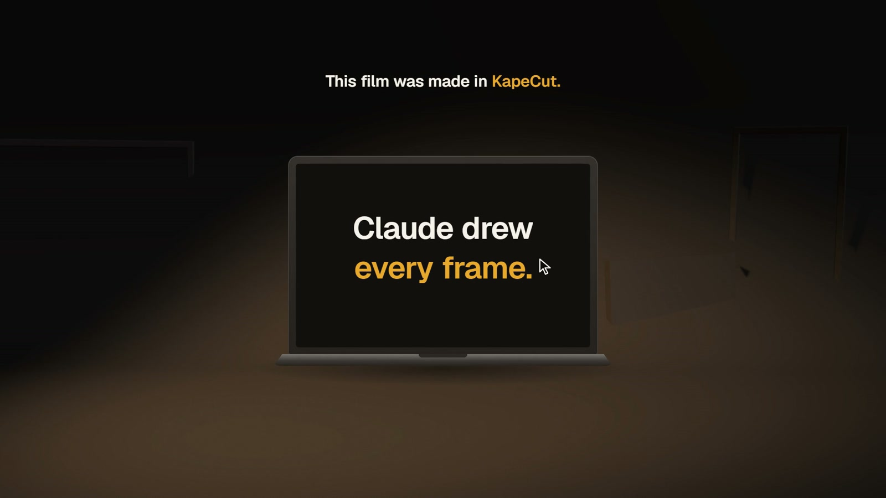

# KapeCut

**A motion design and video editor made for Claude Code.** You describe the video; Claude Code writes every Scene as
code; you review it, point at what to change, and export an MP4. No AI image or video model, no keyframes to drag.



[](docs/media/kapecut-demo.mp4)

Watch the [demo film](docs/media/kapecut-demo.mp4) (77 s, with sound).

## How it helps

Claude Code can already write animation as code. Without KapeCut, though, you can't see a frame of it, point at a
spot to fix, or get an MP4 out. KapeCut supplies those parts:

- **Brief in, video out.** Drop a brief, a logo, fonts and a voiceover into a folder and ask Claude Code for "a KapeCut
  video from this brief". The bundled skill plans the shots and writes one HTML canvas page per Scene for 9:16, 16:9
  or 1:1.
- **See every Frame.** KapeCut plays the real Scene pages with your audio, frame-accurately. It reloads a Scene the
  moment Claude saves it, so you watch the fix land.
- **Point instead of describe.** Pause, press **N** and click the spot, draw a path with **P**, or mark a span on the
  Timeline. Then **Copy Prompt** and paste it into Claude Code. Claude reads each Note's Frame and position, fixes the
  Scene, checks it with a still and ticks the Note off while you watch.
- **Export without a render farm.** MP4 (H.264) at 720p, 1080p, 1440p or 4K. The same code that draws the preview
  draws the export, so what you approved is what you get.
- **Yours to edit.** A Project is a plain folder: `project.json`, the Scene pages, your files and `notes.json`. Open it
  in any editor, put it in git, hand it to someone else.

Good for short-form ads, explainers, kinetic type, product promos and social cut-downs: anything where you'd rather
direct than keyframe.

## Install

KapeCut is free. It runs on Windows 10 or 11 and on Macs, Intel or Apple silicon: the one Mac download runs on both.

### Mac

KapeCut installs on a Mac with one line in Terminal. It is not signed by Apple, so a downloaded copy gets blocked by
macOS; the Terminal line skips that block ([see what it runs](scripts/install-mac.sh)).

1. Open **Terminal**: press **Command + Space**, type `Terminal`, press **Return**.
2. Copy this line, paste it into Terminal (**Command + V**) and press **Return**:

   ```sh
   curl -fsSL https://kapecut.brewedops.cloud/install.sh | bash
   ```

3. Wait while it downloads (about 220 MB). When Terminal says **KapeCut is in /Applications.**, KapeCut opens by
   itself. You can close Terminal.
4. Next time, open KapeCut from **Applications** or Launchpad like any app.

To update, run the same line again. It closes KapeCut, replaces it with the newest version and opens it.

### Windows

1. Open the [latest release](https://github.com/brewed-ops/KapeCut/releases/latest) and, under **Assets**, click
   **KapeCut-Setup-&lt;version&gt;.exe** to download it.
2. Open the downloaded file.
3. If Windows shows **Windows protected your PC**, click **More info**, then **Run anyway**. It asks because the
   installer is not signed yet.
4. Follow the installer (you can keep the suggested folder) and click **Finish**. KapeCut opens.
5. Next time, open KapeCut from the Start menu.

To update, open **Settings > Updates** in KapeCut and click **Check for updates**, then **Update**, then **Restart**.

### First launch (both)

The **Setup** window checks for the tools KapeCut works with: ffmpeg, Claude Code, the KapeCut skill and Chrome or
Edge. For anything missing it shows the install command with a **Copy** button. Install it, then click **Re-check**.
The skill installs with the **Install skill** button. With Claude Code already installed, **Copy Prompt** copies one
prompt that has Claude install the rest for you.

## Run from source

Needs:

- Node 24, or 26 and newer (`npm ci` stops on any other: vitest skips Node 25)
- ffmpeg 4.4 or newer on your PATH, with ffprobe (Export encodes with them)
- [Claude Code](https://claude.com/claude-code) on your PATH (Claude writes the Scenes)
- the KapeCut skill in `~/.claude/skills/kapecut` (KapeCut installs it for you, see below)
- Chrome or Edge (Claude checks each Scene with a still from it; Windows ships with Edge)

```sh
npm ci
npm run dev
```

KapeCut checks all of these on every launch. While one is missing, the Setup window stands in for the editor and
nothing opens. It shows the install command for your OS with a Copy button (KapeCut never runs an installer) and an
**Install skill** button. With Claude Code found, **Copy Prompt** copies one prompt that has Claude run the other
install commands. Install what is missing, then press **Re-check**. Settings lists the same checks.

Open a Project folder with the "Open folder" button, or drop the folder on the window. `examples/` holds two. Drop any other file on the window to copy it into the open Project: it shows in the Files panel, and audio files drag from there onto the Timeline.

## The KapeCut skill

`skills/kapecut/` is a [Claude Code](https://claude.com/claude-code) skill that turns a folder with a brief and
references into a Project: it asks the format (9:16, 16:9 or 1:1), writes `project.json` and one page per Scene
from the 2D canvas starter (`skills/kapecut/starter-2d.html`), and checks every Scene with a still before handing over.

The Setup window installs it into `~/.claude/skills/kapecut` (**Install skill**), and offers **Update skill** whenever
your copy differs from this checkout's, by a hash of every file. Update asks first, since it replaces the whole folder.

Then, in Claude Code, in a folder holding your `brief.md` and references: "make a KapeCut video from this brief".
Open that folder in KapeCut when Claude is done.

Pin Notes on the Frames you want changed, then tell Claude "fix the Notes". It fixes the Scenes, checks each fix with
a still and sets the Notes done (`skills/kapecut/mark-done.mjs`, needs Node 18 or later); KapeCut reloads the Scenes
and turns each fixed Note into a check while you watch.

The Scene contract every page follows is [ADR 0001](docs/adr/0001-scene-contract.md).

## Test

```sh
npm run typecheck
npm test
npm run e2e
npm run dist   # this OS's installer into release/
```

e2e and shots keep the KapeCut window see-through, click-through and unfocused; `KAPECUT_HIDDEN=0 npm run e2e` shows it for debugging.

## License

MIT, except the icons in `src/renderer/icons.ts` (Jiggicons, licensed for KapeCut only). See [LICENSE](LICENSE).
